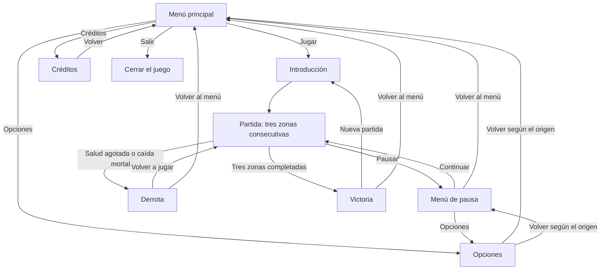

# Night Guardian - Documento de diseño (GDD)

## Índice

1. [Ficha del juego](#1-ficha-del-juego)
2. [Concepto](#2-concepto)
3. [Historia y ambientación](#3-historia-y-ambientación)
4. [Jugabilidad](#4-jugabilidad)
5. [Mecánicas](#5-mecánicas)
6. [Controles](#6-controles)
7. [Niveles](#7-niveles)
8. [Personajes y enemigos](#8-personajes-y-enemigos)
9. [Interfaz y flujo de pantallas](#9-interfaz-y-flujo-de-pantallas)
10. [Dirección de arte](#10-dirección-de-arte)
11. [Sonido y música](#11-sonido-y-música)
12. [Efectos visuales y game feel](#12-efectos-visuales-y-game-feel)
13. [Recursos de terceros](#13-recursos-de-terceros)
14. [Declaración de uso de IA](#14-declaración-de-uso-de-ia)
15. [Aspectos técnicos](#15-aspectos-técnicos)
16. [Diario de desarrollo](#16-diario-de-desarrollo)
17. [Pruebas con jugadores](#17-pruebas-con-jugadores)
18. [Postmortem](#18-postmortem)

## 1. Ficha del juego

| Campo | Información |
|---|---|
| Título provisional | Night Guardian |
| Autor | Javier A. Goldar Picón |
| Género | Acción y plataformas |
| Dimensiones | 2D |
| Plataforma | Windows |
| Versión de Unity y pipeline | Unity 6 con URP. |
| Público objetivo | Compañeros de clase de DAM. |
| Clasificación por edad orientativa | PEGI 7, provisional |
| Duración aproximada de una partida completa | Pendiente de estimar |
| Repositorio GitHub | [pmdm-videojuego-2d](https://github.com/JavierGoldar/pmdm-videojuego-2d) |
| Página del juego en itch.io | Pendiente de crear. |

## 2. Concepto

### Resumen

Un plataformas 2D de acción en el que un espadachín debe proteger su pueblo de una incursión nocturna de demonios. Para detenerla, defenderá la entrada del pueblo y avanzará por sus alrededores, eliminando a los enemigos que se aproximan.

### Pilares de diseño

- **Movimiento ágil y preciso:** el desplazamiento, el salto y el dash permitirán controlar al personaje y superar los obstáculos del recorrido.

- **Combate sencillo y directo:** el espadachín utilizará un ataque básico con katana para enfrentarse a los demonios.

- **Plataformas y combate conectados:** la distribución de las plataformas, los obstáculos y los enemigos influirá en cómo se afronta cada zona.

### Referencias

- **Dan the Man:** referencia para el diseño de plataformas y el combate.

- **Demon Slayer:** referencia temática para la ambientación japonesa, el protagonista espadachín y los demonios nocturnos.

### Qué lo hace diferente

La identidad de Night Guardian se basa en combinar las plataformas de acción con la defensa de un pueblo japonés amenazado por demonios durante la noche.

El jugador asume el papel de un espadachín que comienza defendiendo la entrada del pueblo y después avanza hacia sus alrededores para detener a los demonios que todavía se aproximan. Para progresar, deberá eliminar a todos los enemigos de cada una de las tres zonas del recorrido.

## 3. Historia y ambientación

### Premisa

La historia transcurre en un pueblo japonés, en una época de espadachines. Sus habitantes llevaban una vida normal hasta que, por motivos desconocidos, comenzaron a aparecer demonios durante la noche.

Estos demonios devoran personas para volverse más poderosos. Solo salen de noche porque mueren al entrar en contacto con la luz solar. Para derrotarlos en combate es necesario utilizar una katana.

La aventura comienza cuando los gritos de los habitantes alertan al protagonista de que los demonios están entrando en el pueblo. El espadachín acude a la entrada para detenerlos y, después de eliminar a los enemigos de esa zona, sale hacia los alrededores para enfrentarse a los que todavía se aproximan.

El recorrido estará dividido en tres zonas con distribución y ambientación diferenciadas. Los escenarios exteriores permitirán incorporar obstáculos como muros, desniveles y huecos en el terreno.

### Protagonista

El protagonista es un hombre que lleva veinte años entrenándose como espadachín y vive en el pueblo amenazado.

Al descubrir la incursión, decide actuar para proteger a sus vecinos. Su objetivo es defender la entrada del pueblo y asegurar el recorrido exterior, eliminando a los demonios antes de que puedan alcanzar a sus habitantes.

### Cómo se cuenta la historia

La historia se presentará mediante un texto breve al inicio del juego, que explicará el contexto y la misión del protagonista.

Durante la partida, la ambientación nocturna, los escenarios y la presencia de demonios mostrarán la amenaza que sufre el pueblo.

Al completar las tres zonas, un texto final comunicará que el espadachín ha conseguido detener la incursión y proteger a los habitantes.

## 4. Jugabilidad

### Objetivo del juego

Proteger a los habitantes del pueblo deteniendo la incursión nocturna. Para conseguirlo, el jugador deberá eliminar a todos los demonios de las tres zonas del recorrido, desde la entrada del pueblo hasta sus alrededores.

### Bucle de juego (core loop)

Recorrer el escenario y superar obstáculos mediante el movimiento, el salto y el dash → combatir contra los demonios con la katana → eliminar a todos los enemigos de la zona → avanzar a la siguiente zona.

Este ciclo se repite hasta completar las tres zonas y detener la incursión.

### Condiciones de victoria y de derrota

- **Zona completada:** se consigue al eliminar a todos los demonios de esa zona, permitiendo avanzar a la siguiente.

- **Victoria final:** se consigue al completar las tres zonas del recorrido.

- **Derrota por daño:** se produce cuando la salud del espadachín llega a cero.

- **Derrota por caída:** se produce al caer en un hueco mortal del escenario, independientemente de la salud restante.

La salud del protagonista se representa mediante tres corazones, que disminuyen al recibir golpes. Estos corazones representan puntos de salud, no intentos adicionales.

### Progresión

El espadachín mantiene un máximo de tres corazones de salud durante toda la partida. Al completar una zona y avanzar a la siguiente, comienza con la salud completamente recuperada.

La dificultad aumentará progresivamente mediante la distribución de los enemigos, los retos de plataformas y pequeños incrementos en la resistencia de los demonios.

El daño y la resistencia concretos de los enemigos se ajustarán durante las pruebas del prototipo. No se establece como obligatorio aumentar ambos valores en cada zona: se buscará una dificultad gradual que permita aprender y cometer errores.

Los huecos mortales deberán ser reconocibles y los saltos deberán poder anticiparse para que el jugador comprenda el peligro.

## 5. Mecánicas

### Acciones y mecánicas del personaje

| Acción o mecánica | Descripción | Control | Zonas en las que aparece |
|---|---|---|---|
| Desplazamiento básico | Permite mover al espadachín hacia la izquierda o hacia la derecha para recorrer el escenario. | A: izquierda. D: derecha. | 1, 2 y 3. |
| Salto | Permite alcanzar plataformas y superar obstáculos y huecos del terreno. | W. | 1, 2 y 3. |
| Ataque básico | El espadachín realiza un ataque con su katana para causar daño a los demonios. | E. | 1, 2 y 3. |
| Dash | Permite realizar un desplazamiento rápido de corta distancia para facilitar el movimiento y superar determinadas situaciones del recorrido. | Q. | 1, 2 y 3. |

El desplazamiento básico permite recorrer el escenario, pero no se cuenta como una de las tres mecánicas mínimas del proyecto. Las tres mecánicas principales son el salto, el ataque básico y el dash.

Todas estas acciones están disponibles desde la primera zona y se mantienen durante todo el juego.

### Combinación de las mecánicas

El jugador utilizará el desplazamiento, el salto y el dash para recorrer los escenarios y superar sus obstáculos. El ataque básico permitirá eliminar a los demonios y cumplir la condición necesaria para avanzar a la siguiente zona.

La distribución de plataformas, obstáculos y enemigos buscará que el jugador utilice tanto las habilidades de movimiento como el combate durante el recorrido.

### Parámetros pendientes de ajustar

La velocidad de movimiento, la altura del salto, la distancia y duración del dash, el daño del ataque y los tiempos entre usos se concretarán durante el desarrollo y las pruebas del prototipo.

Estos valores se ajustarán para conseguir un control preciso y una dificultad adecuada al alcance del proyecto.

## 6. Controles

El juego se controlará mediante teclado. Las acciones del personaje estarán disponibles en las tres zonas.

| Acción | Tecla |
|---|---|
| Moverse hacia la izquierda | A |
| Moverse hacia la derecha | D |
| Saltar | W |
| Realizar un ataque básico con la katana | E |
| Realizar un dash | Q |

### Pausa

La tecla para abrir el menú de pausa está pendiente de concretar.

### Presentación de los controles

La forma de enseñar los controles al jugador está pendiente de definir. Se concretará durante el desarrollo para que pueda conocer las acciones disponibles antes de afrontar los primeros retos.

## 7. Niveles

El juego tendrá tres niveles consecutivos. El recorrido comenzará en la entrada del pueblo y continuará por dos zonas de sus alrededores.

En todos los niveles será obligatorio eliminar a todos los demonios para avanzar. Al completar el tercero, se conseguirá la victoria final.

Los nombres de las zonas son provisionales. No habrá contenido opcional, secretos, coleccionables ni objetivos secundarios.

### Nivel 1: Entrada del pueblo

- **Objetivo:** detener a los demonios que están entrando en el pueblo y eliminar a todos los enemigos de la zona.

- **Ambientación:** entrada del pueblo japonés durante la noche.

- **Qué aporta:** presenta las acciones principales del espadachín y las reglas básicas del juego.

- **Diseño previsto:** situaciones sencillas de movimiento, salto, dash y combate que permitan familiarizarse con los controles.

- **Dificultad:** la más baja de los tres niveles.

- **Mapa o boceto:** pendiente de elaborar.

- **Escena de Unity:** pendiente de concretar.

- **Duración aproximada:** pendiente de estimar mediante pruebas.

### Nivel 2: Alrededores del pueblo — primera zona

- **Objetivo:** avanzar fuera del pueblo y eliminar a los demonios que se aproximan por esta zona.

- **Ambientación:** un tramo exterior próximo al pueblo, durante la misma noche.

- **Qué aporta:** una distribución propia de plataformas, obstáculos y enemigos que exija aplicar las acciones aprendidas.

- **Diseño previsto:** retos de plataformas y enfrentamientos de mayor dificultad que en la entrada. Se prevén pequeños ajustes en la resistencia de los enemigos, pendientes de probar.

- **Dificultad:** intermedia.

- **Mapa o boceto:** pendiente de elaborar.

- **Escena de Unity:** pendiente de concretar.

- **Duración aproximada:** pendiente de estimar mediante pruebas.

### Nivel 3: Alrededores del pueblo — segunda zona

- **Objetivo:** eliminar a los demonios de la última zona y completar la defensa frente a la incursión.

- **Ambientación:** otro tramo de los alrededores del pueblo, con una identidad visual diferenciada que está pendiente de concretar.

- **Qué aporta:** el reto final, combinando las mecánicas practicadas durante los niveles anteriores.

- **Diseño previsto:** una distribución de plataformas, obstáculos y enemigos que requiera mayor precisión, manteniendo una dificultad alcanzable.

- **Dificultad:** la más alta de los tres niveles.

- **Mapa o boceto:** pendiente de elaborar.

- **Escena de Unity:** pendiente de concretar.

- **Duración aproximada:** pendiente de estimar mediante pruebas.

### Criterios comunes de diseño

- Todas las acciones del personaje estarán disponibles desde el primer nivel.

- El espadachín comenzará cada nivel con sus tres corazones de salud completos.

- Los huecos mortales deberán ser reconocibles y los saltos deberán poder anticiparse.

- Cada nivel tendrá una distribución propia y aportará diferencias de ambientación, retos o dificultad.

- Las diferencias concretas entre los escenarios se definirán durante su diseño y la selección de assets.

- La organización en Unity deberá incluir al menos dos escenas de juego distintas.

- La duración total se ajustará después de confirmar la indicación del profesor y realizar pruebas.

## 8. Personajes y enemigos

### Personaje del jugador: el espadachín

- **Descripción:** un hombre que lleva veinte años entrenándose como espadachín y vive en el pueblo amenazado.

- **Motivación:** proteger a los habitantes y detener la incursión nocturna de demonios.

- **Arma:** una katana con la que realiza ataques básicos cuerpo a cuerpo.

- **Salud:** un máximo de tres corazones. Recibir golpes reduce su salud y llegar a cero provoca la derrota.

- **Recuperación:** al completar una zona y avanzar a la siguiente, recupera los tres corazones.

- **Acciones:** desplazarse hacia ambos lados, saltar, atacar con la katana y realizar un dash.

- **Aparición:** está presente durante los tres niveles.

Todas sus acciones estarán disponibles desde el comienzo. La velocidad, la altura del salto, las características del dash y el daño del ataque se ajustarán durante las pruebas del prototipo.

### Enemigos: demonios

#### Descripción y contexto

Los demonios son criaturas que aparecen durante la noche y devoran personas para volverse más poderosas. Son vulnerables a los ataques con katana y mueren al entrar en contacto con la luz solar.

La aventura transcurre durante la noche. La vulnerabilidad a la luz solar forma parte del contexto de la historia.

#### Función en el juego

Los demonios son los enemigos a los que se enfrenta el espadachín. Aparecerán en los tres niveles y será obligatorio eliminarlos a todos para completar cada zona.

Inicialmente se prevé utilizar un único tipo de demonio, reutilizado a lo largo del recorrido para mantener un alcance reducido.

#### Comportamiento

Su comportamiento será sencillo y permitirá que amenacen al protagonista y le causen daño durante los enfrentamientos.

La forma concreta de desplazarse, atacar y reaccionar a la presencia del jugador está pendiente de definir y probar durante el prototipo.

#### Cómo se les derrota

El jugador deberá acertar ataques con la katana hasta agotar la salud del demonio.

La cantidad de salud, el daño que causan y los tiempos de ataque se concretarán mediante pruebas. Se prevén pequeños incrementos de resistencia para contribuir a la progresión, manteniendo enfrentamientos equilibrados.

### Obstáculos del escenario

- **Muros y desniveles:** condicionan el recorrido y requieren utilizar las acciones de movimiento.

- **Plataformas:** permiten construir recorridos que requieren saltos y desplazamientos precisos.

- **Huecos mortales:** provocan la derrota al caer en ellos, independientemente de los corazones restantes.

La colocación y dificultad de estos elementos se definirán al diseñar los mapas. Los peligros deberán poder reconocerse y anticiparse.

## 9. Interfaz y flujo de pantallas

### Flujo general

El juego comenzará en el menú principal. Al iniciar una partida, un texto breve presentará la historia y el objetivo del espadachín.

Después, el jugador recorrerá las tres zonas consecutivas. Durante la partida podrá abrir el menú de pausa. Al perder se mostrará la pantalla de derrota y, al completar las tres zonas, la pantalla de victoria.

Desde Opciones se regresará a la pantalla desde la que se haya accedido: menú principal o menú de pausa.

La progresión dentro de la partida será:

Entrada del pueblo → Primera zona exterior → Segunda zona exterior → Victoria.

### HUD durante la partida

El HUD mostrará la salud del espadachín mediante tres corazones. Su representación se actualizará cuando el personaje reciba daño.

La ubicación, el aspecto de los corazones y el boceto de la interfaz están pendientes de concretar.

### Menú principal

Incluirá las siguientes opciones:

- **Jugar:** iniciar una nueva partida.

- **Opciones:** abrir los ajustes de sonido.

- **Créditos:** consultar la autoría del juego y los recursos utilizados.

- **Salir:** cerrar la aplicación en la build para Windows.

### Introducción

Mostrará un texto breve con el contexto de la incursión y la misión del protagonista.

El mecanismo para continuar hacia el primer nivel está pendiente de concretar.

### Menú de pausa

Podrá abrirse durante la partida mediante una tecla pendiente de definir.

Mientras esté abierto, se detendrán los enemigos, las físicas, los temporizadores y las animaciones del juego.

Incluirá:

- **Continuar:** cerrar la pausa y reanudar la partida.

- **Opciones:** abrir los ajustes de sonido manteniendo la partida pausada.

- **Volver al menú principal:** abandonar la partida actual y regresar al menú.

### Menú de opciones

Será accesible desde el menú principal y desde la pausa.

Permitirá modificar por separado:

- El volumen de la música.

- El volumen de los efectos de sonido.

Los cambios se aplicarán en el momento y los valores se mantendrán al cambiar de escena.

Dispondrá de una opción para regresar a la pantalla de origen.

### Pantalla de créditos

Será accesible desde el menú principal e incluirá:

- El nombre del autor del juego.

- Los recursos de terceros utilizados.

- El autor, la licencia y el enlace de cada recurso.

Incluirá una opción para volver al menú principal.

### Pantalla de derrota

Aparecerá cuando el espadachín se quede sin salud o caiga en un hueco mortal.

Permitirá:

- **Volver a jugar:** reiniciar el nivel o la partida. El alcance del reinicio está pendiente de decidir.

- **Volver al menú principal.**

### Pantalla de victoria

Aparecerá al eliminar a todos los demonios de las tres zonas.

Mostrará un texto final indicando que el espadachín ha detenido la incursión y protegido a los habitantes.

Permitirá:

- **Volver a jugar:** comenzar una nueva partida.

- **Volver al menú principal.**

### Aspectos pendientes de diseño

- Elaborar los bocetos del HUD y los menús.

- Seleccionar recursos visuales y tipografías coherentes con la ambientación.

- Definir cómo se enseñarán los controles.

- Concretar la navegación por los menús y la tecla de pausa.

- Organizar las pantallas en escenas o paneles de Unity, respetando el mínimo de dos escenas de juego distintas.

## 10. Dirección de arte

### Estilo visual

El juego tendrá una representación 2D con perspectiva lateral y una ambientación inspirada en un pueblo japonés y sus alrededores durante la noche.

Los escenarios y personajes deberán transmitir la presencia de una amenaza demoníaca y permitir reconocer claramente al protagonista, los enemigos y los obstáculos.

La técnica gráfica concreta, incluida la posibilidad de utilizar pixel art, está pendiente de decidir según los assets disponibles.

### Resolución y escala

La resolución de los sprites se concretará durante la selección de recursos.

Se buscarán personajes, enemigos y escenarios con proporciones y nivel de detalle compatibles. El tamaño de los elementos deberá facilitar la lectura del escenario y la identificación de plataformas y peligros.

### Paleta de colores

La paleta definitiva está pendiente de seleccionar.

Se buscará una apariencia nocturna con suficiente contraste para distinguir al personaje, los enemigos, las superficies transitables y los huecos mortales.

La visibilidad de los elementos necesarios para jugar tendrá prioridad sobre el oscurecimiento de los escenarios.

### Tipografías

Las fuentes están pendientes de elegir.

Se priorizará una tipografía legible para los menús, los textos de historia y los créditos, manteniendo un estilo coherente entre las pantallas.

### Tablero de referencias (moodboard)

Pendiente de elaborar durante la búsqueda y selección de assets.

Recogerá referencias visuales del protagonista, los demonios, la entrada del pueblo y los escenarios exteriores. Permitirá concretar el estilo y comprobar que los recursos elegidos encajan entre sí.

### Coherencia visual

Se priorizará el uso de recursos de un mismo pack o autor cuando cubran las necesidades del proyecto.

Al combinar recursos de distintos autores, se comprobará que compartan un estilo, una resolución y unas proporciones compatibles.

La interfaz será sencilla y mantendrá coherencia con los gráficos del juego. La selección definitiva de recursos y sus posibles cambios se documentarán en el GDD.

## 11. Sonido y música

### Estilo musical

La música acompañará la ambientación japonesa nocturna y los enfrentamientos contra los demonios.

El estilo y las pistas concretas están pendientes de seleccionar. Se buscarán recursos que encajen con la identidad del juego y permitan escuchar claramente los efectos importantes.

### Música de fondo

Se utilizará música de fondo durante la partida. Una misma pista podrá reutilizarse en los tres niveles para mantener un alcance reducido y una ambientación coherente.

La música de los menús está pendiente de concretar. No se establece como necesario disponer de una pista diferente para cada pantalla o nivel.

### Efectos de sonido

Se prevén efectos para las siguientes acciones y eventos:

| Acción o evento | Función del sonido |
|---|---|
| Salto | Comunicar que el personaje ha realizado el salto. |
| Ataque con katana | Acompañar el movimiento del arma. |
| Impacto contra un enemigo | Confirmar que el ataque ha alcanzado al demonio. |
| Dash | Acompañar el desplazamiento rápido. |
| Daño al protagonista | Advertir al jugador de que ha recibido un golpe. |
| Derrota de un demonio | Comunicar que el enemigo ha sido eliminado. |
| Activación de botones | Confirmar las acciones realizadas en los menús. |

Los archivos concretos están pendientes de seleccionar y probar.

### Organización y control del audio

La música y los efectos de sonido se organizarán por separado para poder ajustar sus volúmenes de forma independiente.

El menú de opciones permitirá modificar ambos volúmenes, aplicar los cambios inmediatamente y conservar los valores al cambiar de escena.

Los niveles de volumen se ajustarán durante las pruebas para que la música no oculte los efectos necesarios para comprender lo que ocurre.

### Recursos de audio

Se utilizarán recursos cuya licencia permita incorporarlos al juego y que no hayan sido generados mediante IA.

Cada recurso seleccionado se registrará en el apartado de recursos de terceros y en los créditos, indicando su autor, licencia y enlace.

## 12. Efectos visuales y game feel

### Objetivo

Conseguir que las acciones del espadachín respondan de forma clara y que el jugador pueda reconocer los ataques, los impactos y el daño recibido.

Se priorizarán controles precisos, animaciones comprensibles y efectos de sonido bien coordinados con las acciones.

### Efectos visuales previstos

Como propuesta inicial, se valorarán los siguientes efectos:

| Efecto | Momento de aparición | Finalidad |
|---|---|---|
| Señal visual de impacto | Cuando la katana alcanza a un demonio. | Confirmar que el ataque ha acertado. |
| Cambio visual breve del protagonista | Cuando recibe daño. | Ayudar a reconocer la pérdida de salud. |

La representación concreta de estos efectos dependerá de los recursos disponibles y de las pruebas del prototipo.

Los efectos deberán mantener la coherencia con el estilo gráfico y permitir ver claramente al personaje, los enemigos y los obstáculos.

### Cámara

Se prevé una cámara que siga al protagonista y mantenga visible el recorrido necesario para anticipar saltos, obstáculos y enemigos.

Su desplazamiento y sus límites se ajustarán durante las pruebas para evitar movimientos molestos y mostrar zonas ajenas al escenario.

### Iluminación

La iluminación reforzará la ambientación nocturna, manteniendo visibles los elementos necesarios para jugar.

Su configuración concreta dependerá del estilo gráfico y de los assets seleccionados. Se priorizará distinguir las plataformas, los enemigos y los huecos mortales.

### Respuesta de las acciones

Se buscará que:

- El movimiento, el salto y el dash respondan de forma precisa.

- El ataque tenga una representación visual reconocible.

- Los impactos y el daño recibido tengan señales visuales y sonoras claras.

- Los corazones del HUD reflejen correctamente la salud restante.

- Los botones comuniquen su activación mediante sonido.

### Ajuste y alcance

Estas mejoras se incorporarán después de conseguir que las mecánicas principales y los requisitos mínimos funcionen correctamente.

Su intensidad y duración se ajustarán mediante pruebas para que ayuden a jugar sin distraer ni dificultar la lectura del escenario.

La selección final de efectos se actualizará en este apartado según lo implementado.

## 13. Recursos de terceros

La selección de recursos gráficos, música, efectos de sonido y tipografías está pendiente.

Cada recurso de terceros que se incorpore al proyecto se registrará en la siguiente tabla.

| Recurso | Tipo | Autor | Licencia | Enlace | Dónde se usa |
|---|---|---|---|---|---|

### Criterios de selección y registro

- Comprobar que la licencia permite utilizar el recurso en el juego.

- Revisar qué archivos incluye la descarga gratuita y sus condiciones de uso.

- Comprobar que el recurso no ha sido generado mediante IA.

- Buscar coherencia de estilo, resolución y proporciones entre los recursos gráficos.

- Registrar el nombre del recurso, su autor, su licencia, el enlace de origen y su uso en el proyecto.

- Indicar las modificaciones realizadas, si las hubiera.

- Incluir los recursos utilizados en los créditos del juego.

La tabla se actualizará cada vez que se incorpore un recurso y deberá coincidir con los créditos y con el contenido de la versión final.

## 14. Declaración de uso de IA

### Herramienta utilizada

Se ha utilizado ChatGPT, de OpenAI, como herramienta de apoyo durante la preparación inicial del proyecto.

### Usos realizados

La ayuda se ha empleado para:

- Analizar los requisitos, los hitos y la rúbrica de evaluación.

- Valorar y acotar una propuesta de videojuego adecuada al tiempo disponible y a la falta de experiencia inicial con Unity.

- Explorar títulos y concretar la idea a partir de las decisiones del autor.

- Revisar la coherencia de las mecánicas, las condiciones de victoria y derrota y la progresión.

- Generar borradores, revisar y organizar la redacción de apartados del GDD en formato Markdown.

- Resolver dudas sobre la preparación del repositorio y la documentación.

### Revisión y cambios sobre las propuestas

Las propuestas se han revisado y ajustado durante la conversación. Entre las decisiones tomadas destacan:

- Cambiar el recorrido desde el interior del pueblo hacia su entrada y sus alrededores.

- Sustituir la reducción de corazones entre zonas por una salud máxima constante de tres corazones.

- Mantener un alcance reducido y dejar los valores de daño, resistencia y movimiento pendientes de probar.

Los borradores generados con ayuda de IA describen una propuesta inicial. Su contenido deberá contrastarse con el desarrollo real y actualizarse cuando cambien las decisiones.

### Recursos audiovisuales

No se ha utilizado IA generativa para crear recursos gráficos, animaciones, música, efectos de sonido ni efectos visuales destinados al juego.

Los recursos de terceros se revisarán antes de incorporarlos para comprobar que cumplen las condiciones de la asignatura.

### Actualización de la declaración

Si posteriormente se utiliza IA para explicar conceptos, generar código, revisar scripts o ayudar a depurar errores, se registrarán las partes afectadas, las modificaciones realizadas y los problemas encontrados.

El autor deberá comprender y poder explicar todo el código que entregue.

## 15. Aspectos técnicos

### Motor y plataforma

- **Motor:** Unity 6.

- **Pipeline de renderizado:** Universal Render Pipeline (URP).

- **Plantilla prevista:** Universal 2D.

- **Lenguaje de programación:** C#.

- **Plataforma de entrega:** Windows.

- **Versión exacta del Editor:** pendiente de concretar al crear el proyecto.

### Estructura del proyecto

El repositorio incluye la documentación en `Docs/GDD.md`. Las imágenes de documentación se guardarán en `Docs/img`.

Al crear el proyecto de Unity, los recursos se organizarán en subcarpetas según su función:

- `Assets/Scenes`: escenas.

- `Assets/Scripts`: código.

- `Assets/Prefabs`: objetos reutilizables.

- `Assets/Sprites`: recursos gráficos propios.

- `Assets/Animations`: animaciones.

- `Assets/Audio/Music`: música.

- `Assets/Audio/SFX`: efectos de sonido.

- `Assets/UI`: recursos de interfaz.

- `Assets/Fonts`: tipografías.

- `Assets/ThirdParty`: packs de terceros, separados por recurso o pack.

La estructura se actualizará según las necesidades reales del proyecto. Se utilizarán nombres descriptivos y se retirarán los recursos de prueba que no formen parte del juego.

### Escenas

La organización definitiva de las escenas está pendiente de concretar.

Deberá permitir recorrer los tres niveles e incluir al menos dos escenas de juego distintas, además de las necesarias para los menús.

Las pantallas de opciones, créditos y pausa podrán utilizar paneles para mantener una estructura sencilla.

### Organización del código

Los scripts y su comunicación se definirán durante el prototipo.

Las responsabilidades que habrá que cubrir incluyen:

- Movimiento, salto y dash del protagonista.

- Ataque y recepción de daño.

- Comportamiento y salud de los demonios.

- Comprobación de enemigos restantes y finalización de zonas.

- Victoria, derrota y cambios de nivel.

- Interfaz, pausa y opciones de audio.

Cuando estén implementados, se documentarán los nombres de los scripts principales, sus responsabilidades y cómo se relacionan.

### Paquetes de Unity

Los paquetes utilizados se registrarán durante el desarrollo, indicando para qué se emplea cada uno.

Se mantendrán los necesarios para el juego y los incluidos por defecto en la plantilla, retirando los instalados para pruebas que finalmente no se utilicen.

### Gestión de datos

Los valores de volumen de música y efectos deberán mantenerse al cambiar de escena.

El mecanismo para conservar esos valores está pendiente de concretar. El guardado entre ejecuciones y el guardado del progreso no forman parte del alcance inicial.

### Control de versiones

Se utilizará Git y el repositorio de GitHub del proyecto para registrar los avances mediante commits durante el desarrollo.

El archivo `.gitignore` de Unity excluirá las carpetas generadas que no deben incorporarse al repositorio, como `Library`, `Temp` y `Logs`.

### Problemas técnicos y soluciones

Este subapartado se completará durante la implementación, registrando los problemas importantes, su causa y la solución aplicada.

### Errores conocidos

Se documentarán los errores pendientes de resolver y sus efectos sobre la partida. Esta información se actualizará antes de la entrega final.

## 16. Diario de desarrollo

### 16 de octubre de 2026 — Definición inicial del proyecto

**Trabajo realizado:**

- Revisión de los requisitos, los hitos y la rúbrica de evaluación.

- Planteamiento de un videojuego 2D de acción y plataformas inspirado en Dan the Man, con ambientación japonesa y demonios nocturnos.

- Definición inicial del protagonista y de su misión de proteger el pueblo.

- Selección de tres mecánicas principales: salto, ataque con katana y dash.

- Revisión del calendario de entregas, con fecha final el 14 de febrero de 2027.

**Dudas y dificultades:**

- Falta de experiencia inicial con Unity.

- Necesidad de ajustar el alcance al tiempo disponible y al resto de asignaturas.

- Selección de assets pendiente.

**Decisiones tomadas:**

- Mantener un personaje jugable, un ataque básico, enemigos sencillos y tres niveles cortos.

- Conservar la ambientación como propuesta revisable según los recursos disponibles.

- Priorizar los requisitos mínimos antes de añadir ampliaciones.

### 17 de octubre de 2026 — Repositorio y comienzo del GDD

**Trabajo realizado:**

- Creación del repositorio `pmdm-videojuego-2d` en GitHub.

- Preparación del repositorio con README y `.gitignore` de Unity.

- Clonado del repositorio y apertura en VS Code.

- Creación de `Docs/GDD.md`.

- Elección de Night Guardian como título provisional.

- Preparación de la ficha del juego y desarrollo inicial del concepto.

**Dudas y cuestiones pendientes:**

- Confirmar la indicación del profesor sobre la duración máxima.

- Concretar la versión exacta del Editor de Unity.

- Seleccionar los recursos gráficos y sonoros.

**Decisiones tomadas:**

- Definir el género como acción y plataformas.

- Establecer Windows como plataforma de entrega y Unity 6 con URP como motor y pipeline.

- Identificar a los compañeros de clase de DAM como público objetivo inicial.

- Mantener PEGI 7 como orientación provisional, sujeta a revisión según el contenido final.

### 18 de octubre de 2026 — Desarrollo del diseño y ajuste del alcance

**Trabajo realizado:**

- Preparación de los apartados del GDD desde la ficha del juego hasta los aspectos técnicos.

- Definición de los controles del protagonista.

- Concreción de las condiciones de victoria y derrota.

- Planificación provisional de niveles, personajes, enemigos, interfaz, arte, audio y efectos.

- Preparación del registro de recursos de terceros y de la declaración de uso de IA.

**Dudas y dificultades:**

- Diferenciación entre corazones de salud e intentos adicionales.

- Revisión de cómo aumentar la dificultad sin reducir excesivamente el margen de error.

- Necesidad de justificar los obstáculos de plataformas dentro de la ambientación.

**Decisiones y cambios:**

- Sustituir el recorrido por el interior del pueblo por uno que comience en su entrada y continúe por los alrededores. Este cambio facilita justificar plataformas, muros, desniveles y huecos.

- Mantener tres corazones de salud máxima durante toda la partida y recuperar la salud al avanzar a una nueva zona.

- Descartar la reducción inicial de tres a dos y después a un corazón.

- Dejar el daño y la resistencia de los enemigos pendientes de ajustar mediante pruebas.

- Establecer la caída en huecos mortales como otra condición de derrota.

- Exigir la eliminación de todos los demonios para completar cada zona y conceder la victoria al completar las tres.

- Limitar opciones y créditos a las funciones mínimas exigidas.

- Mantener como provisionales los mapas, los assets y los parámetros que necesitan comprobarse en el prototipo.

**Próximos pasos:**

- Revisar el GDD y las instrucciones concretas de entrega del primer hito.

- Registrar los avances de documentación en Git y subirlos al repositorio.

- Comenzar la preparación del proyecto de Unity y el aprendizaje necesario para desarrollar el prototipo.

## 17. Pruebas con jugadores

Pendiente de realizar cuando exista una versión jugable.

Antes de la entrega final, al menos tres personas probarán el juego sin recibir explicaciones previas sobre cómo jugar.

Para cada prueba se registrará:

- Quién ha probado el juego y qué versión.

- Dónde se ha atascado o qué no ha entendido.

- Qué le ha gustado y qué mejoraría.

- Los cambios realizados a partir de sus observaciones.

## 18. Postmortem

Pendiente de redactar al finalizar el proyecto.

La reflexión final incluirá:

- Qué ha salido bien.

- Qué ha salido mal o no ha dado tiempo a completar y por qué.

- Las diferencias entre la idea inicial y el juego entregado.

- Qué he aprendido durante el desarrollo.

- Qué haría de forma diferente si empezara de nuevo.
